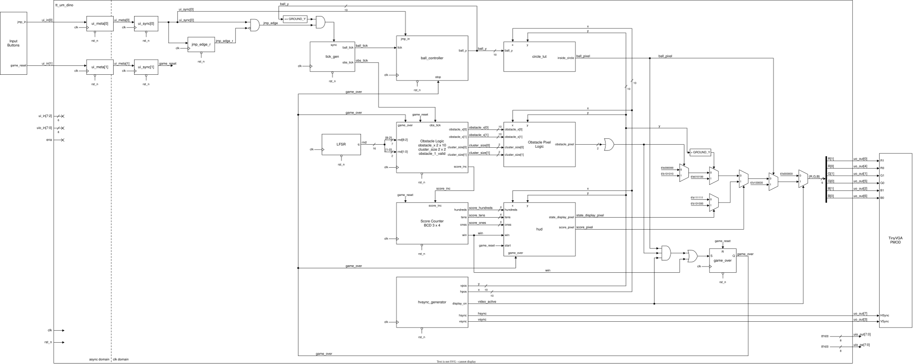

   
# Dino VGA: Hardware Obstacle-Avoidance Game

A hardware implementation of a single-button obstacle-avoidance game, with all game logic in RTL and real-time video output through a VGA display. No processor and no frame buffer are used.

## Overview

A red ball stands at a fixed position on the left of the screen. Clusters of 1 to 4 grey spikes scroll in from the right, and the player presses one button to jump over them. Each cleared cluster scores one point. The game ends with a collision (**YOU DIED**) or with a win when the score reaches **999** (**YAY**).

Every pixel is computed combinationally from the current VGA beam position. The ball, spikes, ground, score and messages are all evaluated per pixel, and a pixel overlap between the ball and a spike is the collision test.

The ball uses a speed-dependent update period, so it accelerates and decelerates like real gravity without a multiplier. Spikes are drawn as the region under the lines `y > 2x` and `y > -2x`, with a per-spike offset to form clusters.

## Features

- **Jump physics** with initial speed -13 and gravity +5 per tick. A look-up table converts speed into a pixel update period, so the ball is fastest near the ground and slowest at the peak.
- **Two independent obstacle slots**, each a cluster of 1 to 4 spikes with random cluster size and random spawn position from a 16-bit LFSR.
- **Triangle spikes** 23 px tall and about 23 px wide, spaced 32 px apart inside a cluster.
- **60 px circular ball** drawn from a quadrant look-up table (half-widths for radius 30).
- **Pixel-overlap collision detection** between the ball and spikes.
- **Win detection** at score 999, and **3-digit BCD score** drawn as seven-segment digits.
- **On-screen messages** drawn as seven-segment glyphs: START, YOU DIED, YAY.
- **Game reset input** that clears score, obstacles and game state without a chip reset.
- **Reset synchroniser** with asynchronous assert and synchronous release for all logic.
- **Two-flop input synchronisers** on the jump and game-reset inputs.
- **Tick generator restarted on jump**, so every jump behaves identically and spawn timing depends on the player.
- **VGA output** at 640x480, about 60 Hz, with a 25.175 MHz pixel clock and 2 bits per colour channel.

## Demo

  
   
  <em>Game over: collision</em>

  
   
  <em>Game win: score 999</em>

## Architecture

The jump and game-reset inputs pass through two-flop synchronisers. The tick generator produces a slow `ball_tick` (gravity step) and `obs_tick` (obstacle step). `ball_controller` turns ticks and the jump input into the ball's vertical position. The top-level logic moves the obstacles, draws the spikes, counts the score and detects collisions and wins. `hud` draws the score and messages. `hvsync_generator` produces the VGA timing and pixel coordinates used by every renderer, and a colour mux selects the final RGB value.

  
   
  <em>Design microarchitecture</em>

## Top-Level Interface

### Input Ports

| Signal | Purpose |
|---|---|
| `ui_in[0]` | Jump |
| `ui_in[1]` | Game reset (hold to show START, release to play) |
| `ui_in[7:2]` | Unused |
| `uio_in[7:0]` | Unused |
| `ena` | Unused |
| `clk` | Clock, 25.175 MHz |
| `rst_n` | Active-low reset |

### Output Ports

| Signal | Purpose |
|---|---|
| `uo_out[7:0]` | {hsync, B[0], G[0], R[0], vsync, B[1], G[1], R[1]} (TinyVGA PMOD) |
| `uio_out[7:0]` | Unused, tied to 0 |
| `uio_oe[7:0]` | Unused, tied to 0 |

### Main RTL blocks

| Module | Responsibility |
|---|---|
| [`tt_um_dino.v`](src/tt_um_dino.v) | Top level: input sync, obstacle movement and spike rendering, scoring, collision and win detection, colour mux. |
| [`rst_sync.v`](src/rst_sync.v) | Asynchronous-assert, synchronous-release reset synchroniser. |
| [`tick_gen.v`](src/tick_gen.v) | 21-bit counter producing `ball_tick` (2^21 clocks) and `obs_tick` (2^16 clocks), restartable on jump. |
| [`ball_controller.v`](src/ball_controller.v) | Jump and gravity physics, outputs the ball's vertical position. |
| [`circle_lut.v`](src/circle_lut.v) | Look-up table deciding whether the current pixel is inside the ball. |
| [`LFSR.v`](src/LFSR.v) | 16-bit pseudo-random source for cluster size and spawn positions. |
| [`hud.v`](src/hud.v) | Draws the 3-digit score and the START / YOU DIED / YAY messages. |
| [`hvsync_generator.v`](src/hvsync_generator.v) | VGA sync signals and pixel coordinates. |

## How It Works

1. The jump input is synchronised and, if the ball is on the ground with zero speed, sets the ball's speed to -13 (upwards). The tick counter restarts at the same moment.
2. On every `ball_tick` the speed increases by 5. A look-up table maps the absolute speed to a period, and the ball moves one pixel each time an internal counter reaches that period. On reaching the ground (y = 400) the ball is clamped and its speed is reset to 0.
3. On every `obs_tick`, both obstacles move one pixel to the left (about 384 px/s). Obstacle 0 respawns at a random x in 896-1023 when it reaches x = 0. Obstacle 1 is activated when obstacle 0 passes x = 511 and is deactivated when it reaches x = 0.
4. Each obstacle has a random cluster size (0-3 extra spikes) sampled from the LFSR. Extra spikes are drawn at multiples of 32 px to the left of the base spike.
5. For each pixel, the renderer tests the two lines `dy > 2*dx` and `dy > -2*dx` per spike. The circle look-up table tests the ball.
6. If a ball pixel and a spike pixel coincide in the visible area, `game_over` is set. All motion and scoring freeze, and YOU DIED is shown.
7. The score increases by one when a cluster's base spike reaches x = 20, which is behind the ball. At 999 the game is won, and YAY is shown.
8. Raising the game-reset input clears the score, obstacles and game state and shows START. Releasing it starts a new game.

## Running the Project

### External hardware

- A Tiny Tapeout board or an FPGA board programmed with this design.
- A **TinyVGA PMOD** on `uo_out` and a VGA display supporting **640x480 at about 60 Hz**.
- A **25.175 MHz** clock.
- A push button on `ui_in[0]` (jump), a push button on `ui_in[1]` (game reset) and a reset input for `rst_n`.

### How to test

1. **Power-on / reset:** Apply `rst_n` low, then release it. The screen shows a red ball on the ground at the left, a ground area below y = 400 and `000` in the top-right corner.
2. **Start screen:** Hold `ui_in[1]` high. START appears and no obstacles are on screen. Release it to start the game.
3. **Jump:** Press `ui_in[0]`. The ball rises, slows at the peak and falls back to the ground. Pressing in mid-air has no effect.
4. **Obstacles:** After about 1 s a first spike appears from the right. Check that clusters of 1 to 4 spikes appear and that obstacles reappear after leaving the left edge.
5. **Score:** Jump over a cluster and confirm the score increases by one after it has passed behind the ball.
6. **Game over:** Touch a spike. The ball and obstacles freeze and YOU DIED is shown.
7. **Restart:** Raise `ui_in[1]`. START appears, the score returns to `000` and obstacles restart from off-screen. Release it to play again.
8. **Win:** Reach score 999 (best done in simulation). YAY is shown and the game freezes.

The design can be tried in the browser on VGA Playground: [Open in VGA Playground](https://vga-playground.com/?repo=https://github.com/Bhavvv-29/Dino-Inspired-VGA-Obstacle-Avoidance-Game)

OR

Use the VGA Simulator: [vga_sim](https://github.com/jar/vga_sim) 

## Limitations

1. **No increasing speed.** There is no increase in speed with the score, like in the real chrome dino game.
2. **Fixed 32 px spike spacing and fixed timing.** Speeds and spacing are tuned for a 25.175 MHz clock.

## Contributors

| Name | GitHub | 
|---|---|
| Adithya Prakash | [@ap2108](https://github.com/ap2108) |
| Bhavani Shri | [@Bhavvv-29](https://github.com/Bhavvv-29) |
| Idhant Sood | [@soodidhant](https://github.com/soodidhant) |

